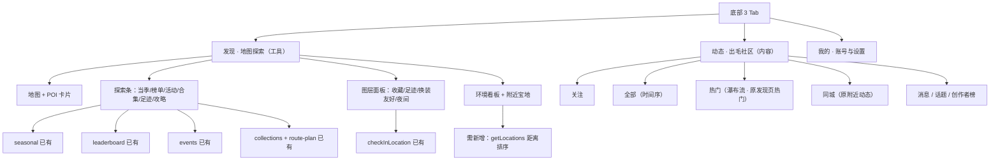

# 出毛日记 · 「动态 / 发现」功能区重组方案

> 撰写日期：2026-09-27
> 依据：`pages/discover/`（发现页）、`pages/posts/`（动态页）、`app.json`（TabBar）、`.trae/documents/新的小程序设计逻辑`、`SPEC.md`、`交付文件/07-低成本运行与数据模型.md`、`交付文件/08-附近动态地理索引迁移.md`
> 范围：仅做信息架构与功能归属重新设计，不含代码改动

---

## 一、结论摘要（先看这段）

1. **社交类功能确实分散且严重重复**，不是"感觉"，是数据源层面的重复：发现页的「热门日记」与动态页的「全部」，发现页的「附近动态」与动态页的「同城」，**调用的是同一个云函数 `getPosts`，只是参数不同**（`sort:'hot'` / 无参 / `tab:'nearby'`）。同一个内容流被拆到两个 Tab，用户要在两个入口之间猜"内容在哪"。
2. **建议把「动态」做成内容社交唯一大区**：Tab 结构改为 `关注 / 全部 / 热门 / 同城`，把发现页的热门瀑布流与附近动态**整体迁入**，发现页不再承载内容流。
3. **发现页回归"地图工具"本色**——只答一个问题："**去哪拍、怎么去**"。在腾出热门/附近之后，它的位置会空出来，正好可以装入现在**藏得很深、但对拍照党价值最高的一批功能**：
   - 已经做好但入口极隐蔽的：**当季宝地**（`seasonal`）、**线下活动**（`events`）、**热门地点榜**（`leaderboard`）、**地点合集 / 路线**（`collections` `route-plan`）、**出毛攻略**（尚未开发）
   - 与地图天然一体、需要新增的：**附近宝地**（替代原附近动态）、**图层切换**（我的收藏 / 我的足迹 / 换装友好）、**区域内搜索**、**紫外线与最佳拍摄时段**
4. 落地建议走**方案 B（推荐）**：发现页新增一条横向「探索条」+ 图层面板 + 把浮动面板内容从"附近动态"换成"附近宝地"；动态页承接全部内容流。其中 `getLocations` **目前不支持按距离排序**，是"附近宝地"的唯一硬依赖，需要先补 `geoLocation` 字段与索引。

---

## 二、现状盘点：哪里散、哪里重

### 2.1 当前三个 Tab 的实际内容

| Tab | 页面 | 承载的功能 |
| --- | --- | --- |
| 发现 | `pages/discover/discover` | 顶部：搜索框（→ `search`）、城市选择、头像；右上角两个小图标 → `events`（活动）、`seasonal`（季节）<br>分段控件：**地图 / 热门**<br>地图模式：地图标点、POI 预览卡片、多维筛选、FAB（上传地点）、浮动面板（环境看板 + **附近动态 5 条**）<br>热门模式：**双列瀑布流热门日记**、FAB（发动态） |
| 动态 | `pages/posts/posts` | Tab：**关注 / 全部 / 同城**；帖子 Feed（点赞/踩、评论、分享、关联地点）；FAB（发动态） |
| 我的 | `pages/profile/profile` | 消息入口、**热门排行榜**、**我的地点合集**、管理员中心；动态 / 收藏 / 地点 三个列表 |

### 2.2 重复项（同源不同壳）

| # | 重复内容 | A 入口 | B 入口 | 实际数据源 | 问题 |
| --- | --- | --- | --- | --- | --- |
| 1 | 热门内容流 | 发现页「热门」模式（瀑布流） | — | `getPosts { sort:'hot' }` | 藏在"发现"里，与"动态"语义冲突；用户找热门内容会先点"动态" |
| 2 | 附近内容流 | 发现页浮动面板「附近动态」 | 动态页「同城」Tab | `getPosts { tab:'nearby', latitude, longitude }` | **完全同一功能两个入口**，一处是列表一处是卡片，样式还不一致 |
| 3 | 发动态 | 发现页热门模式 FAB | 动态页 FAB | `post-create` | 两个入口同一动作，发现页的 FAB 还会随模式变化（上传地点/发动态），用户难以建立肌肉记忆 |
| 4 | 内容消费 | 动态页「全部」 | 发现页热门 | 同一 `posts` 集合 | 两套卡片样式（list card / waterfall card）维护成本翻倍 |

### 2.3 隐藏项（做完了却没人找得到）

| 功能 | 页面 | 现有入口 | 发现难度 |
| --- | --- | --- | --- |
| 当季宝地推荐 | `pages/seasonal` | **发现页右上角一个太阳小图标** | 极高，且与"筛选"功能语义混淆 |
| 线下活动聚会 | `pages/events` `event-detail` `event-create` | **发现页右上角一个日历小图标** | 极高 |
| 热门地点榜 / 活跃创作者榜 | `pages/leaderboard` | **我的页**（个人中心里放排行榜，语义错位） | 高 |
| 地点合集 / 路线规划 | `pages/collections` `route-plan` | 我的页 → 合集 → 路线 | 高，且与地图割裂（合集本体就是一堆坐标） |
| 分享卡片生成 | `pages/share-card` | 详情页内 | 中 |
| 标签聚合页 | `pages/tag-content` | 详情页标签点击 | 中 |
| 出毛攻略（入门/装备/安全/避坑） | **不存在** | 无 | 设计逻辑文档已要求，未落地 |
| 出毛安全中心（穿戴计时提醒等） | **不存在** | 无 | 设计逻辑文档已要求，未落地 |

### 2.4 一句话诊断

> 现在的分工是「**发现 = 地图 + 热门 + 附近 + 活动 + 季节**」，「**动态 = 全部 + 关注 + 同城**」。
> 前者是**混合体裁**（工具 + 内容 + 运营），后者才是纯内容。
> 正确分工应当是 **发现 = 找地方（工具）**，**动态 = 看人和内容（社区）**。当前唯一"越界"的是热门与附近动态。

---

## 三、重组后的信息架构

```
底部 Tab（维持 3 个，不改数量）
│
├─ 1. 发现（地图探索）——「去哪拍、怎么去」
│   ├─ 顶部：搜索 / 城市 / 消息
│   ├─ 探索条（横向胶囊）：当季宝地 · 热门地点 · 线下活动 · 地点合集 · 我的足迹 · 出毛攻略
│   ├─ 主视图：地图 + 标点 + POI 预览卡片
│   │   ├─ 图层面板：全部 / 我的收藏 / 我的足迹 / 换装友好 / 夜间可拍
│   │   └─ 区域内搜索（拖动地图后出现）
│   ├─ 底部浮动面板：出毛环境看板（温/湿/风/紫外线）+ 附近宝地卡片
│   └─ FAB：添加地点（主）｜发动态（次，长按或第二颗按钮）
│
├─ 2. 动态（出毛社区）——「谁在拍什么」
│   ├─ Tab：关注 / 全部 / 热门 / 同城
│   │   ├─ 全部：时间序 Feed（现有 post-card）
│   │   ├─ 热门：双列瀑布流（复用 hot-diary-card）
│   │   ├─ 同城：按距离半径的内容流（半径选择 5/10/20/50km）
│   │   └─ 关注：需登录
│   ├─ 顶部右侧：消息铃铛（未读角标）
│   ├─ 内容区入口：话题/标签页、活跃创作者榜
│   └─ FAB：发动态
│
└─ 3. 我的（个人中心）—— 账号 / 内容管理 / 设置
    └─ 移除：排行榜、地点合集（迁往发现）
```



---

## 四、动态功能区：整合方案

### 4.1 目标结构

| Tab | 内容 | 排序/来源 | 复用 | 新增工作量 |
| --- | --- | --- | --- | --- |
| 关注 | 已关注用户的动态 | `getPosts { tab:'follow' }` | 现有 | 无 |
| 全部 | 全站最新动态 | `getPosts {}` | 现有 | 无 |
| **热门** | 双列瀑布流 | `getPosts { sort:'hot' }` | **从发现页迁移**，复用 `hot-diary-card` | 组件注册 + 分页器 |
| **同城** | 按距离的内容流 | `getPosts { tab:'nearby' }` | 现有（原「同城」）+ 原发现页附近动态合并 | 半径选择器（可选） |

要点：
- **Tab 由 3 个变 4 个**，指示器宽度 33.33% → 25%（`posts.wxss` 的 `.tab-indicator`）。
- 每个 Tab 需要**独立分页状态**。可直接照搬 `profile.js` 已有的 `pagers` 映射写法（每个 tab 一个 `createPager` 实例），避免当前"单 pager + 手改 page/hasMore"的写法在 4 个 Tab 下互相污染。
- 瀑布流与列表混排：热门 Tab 用 `.waterfall-container` 双列（从 `discover.wxss` 迁移样式），其余 Tab 用 `post-card` 列表。
- 顶部右侧建议放消息铃铛（未读角标），把社交闭环的提醒收敛到内容 Tab；`profile` 页铃铛可保留。
- 「发动态」FAB 在动态页固定不变，成为唯一一处发动态的显性入口。

### 4.2 从发现页带走的东西

| 迁移项 | 原位置 | 去向 | 备注 |
| --- | --- | --- | --- |
| `hotPosts / hotPage / hotHasMore / hotLoading / hotError` 及相关方法 `_loadHotPosts / onHotRetry / onDiaryTap / onDiaryLocationTap` | `discover.js` | `posts.js` | 与现有 pager 并存，注意命名区分 |
| 瀑布流 WXML 段（`.waterfall-container`、`hot-diary-card`） | `discover.wxml` 298–350 行 | `posts.wxml` 热门分支 | 组件是全局组件（`app.json` 已注册 `icon`，`hot-diary-card` 需在 `posts.json` 注册） |
| 「还没热门日记」空状态 | `discover.wxml` | `posts.wxml` | 保留引导发第一篇 |
| 分段控件「地图/热门」 | `discover.wxml` 46–90 行 | **删除** | 若需要"地图/列表"视图，另设按钮，不叫"热门" |
| `_loadNearbyLocations`（附近动态） | `discover.js` 640–653 行 | **改名 + 改数据源**：`_loadNearbySpots`（附近地点） | 见 5.1 |
| 上下文 FAB（`viewMode === 'map'` 判断） | `discover.js` `onFabTap` | 简化为固定"添加地点" | 发动态入口移出，或改为长按二级菜单 |

### 4.3 顺带修掉的体验问题

- 动态页 Tab 目前无横向滑动切换，4 个 Tab 后建议补 `swiper` 或手势切换。
- 同城 Tab 现无半径概念（云函数默认 50km 上限、`safeRadius` 最小 1km）。建议给用户 5/10/20/50km 选择，并在空状态提示"附近 50km 内暂无动态，试试扩大范围"。
- 「同城」与「附近」两个词在项目里混用（`tab:'nearby'` 文案叫"同城"，发现页面板叫"附近动态"）。统一为 **同城**（内容侧）/ **附近宝地**（地点侧）。

---

## 五、发现功能区：可以放入哪些功能（核心回答）

腾出热门与附近动态后，发现页的位置正好用来装载"**去拍摄前需要的决策信息**"。以下按"优先级 + 是否已有实现"分三档。

### 5.1 第一档：改造现有内容，立刻能上（0 新增云函数）

| # | 功能 | 做法 | 现有可复用 | 建议入口位置 |
| --- | --- | --- | --- | --- |
| 1 | **附近宝地** | 把浮动面板里的"附近动态"换成"**附近地点**"卡片（封面 + 名称 + 距离 + 评分/换装间标签），点击进地点详情 | `getLocations`（**需补距离排序**，见 7.1）、`buildDistanceText`（discover.js 已有）、`computeHeat/heatLabel`（已有热度算法） | 底部浮动面板（原位置） |
| 2 | **当季宝地** | 右上角太阳小图标 → 升级为探索条里的「当季宝地」胶囊，含季节标签与封面 | `seasonal` 页面 + `getSeasonalLocations` | 探索条 |
| 3 | **热门地点榜** | 只取榜单的"地点"部分（活跃创作者部分留在动态） | `leaderboard` 页面 + `getLeaderboard` | 探索条 |
| 4 | **地点合集 / 路线** | 从我的页迁入；并支持"**在地图上显示该合集**"（合集本质是一座座坐标） | `collections` `route-plan` + `manageCollections`（`detail` 已返回含经纬度的 locations） | 探索条 + 图层面板 |
| 5 | **我的足迹** | 把 `checkInLocation` 的签到记录作为地图图层渲染（另一种标点样式） | `checkInLocation` 已有；查询"我的签到"需新增一个读取接口 | 图层面板 |
| 6 | **地图图层切换** | 全部 / 我的收藏 / 我的足迹 / 换装友好 / 夜间可拍 | 收藏关系：`getLocations` 已返回 `isFavorited`；`getUserContent { tab:'favorite' }` 可拉收藏列表；设施过滤：`getLocations` 的 `matchesOneFilter` 已支持 `shade/restroom/changing/parking` | 地图右上悬浮按钮 |
| 7 | **环境看板补紫外线** | 现有 温度/湿度/风力/天气，设计稿要求含**紫外线**；顺带加一句"适合出毛指数"结论（如"紫外线强，建议 16:00 后"） | `getWeather`（需确认是否返回 UV 字段） | 浮动面板顶部（原位置） |
| 8 | **区域内搜索** | 拖动地图后出现"在此区域搜索"，把视野范围作为筛选条件 | `getLocations` 需支持 bbox/中心点半径 | 地图浮层 |

### 5.2 第二档：小幅新增即可显著提升"找地方"效率

| # | 功能 | 说明 | 依赖 |
| --- | --- | --- | --- |
| 9 | **出毛攻略入口** | 入门指南 / 装备科普 / 安全守则 / **场地避坑**。放在发现页的价值是"去之前先看"，其中"场地避坑"与地点强相关 | 新页面 + 内容集合（设计逻辑文档已要求，当前完全空白） |
| 10 | **地点卡片增强** | POI 卡片增加"导航 / 收藏 / 加入合集 / 看此地动态"四个动作，其中"看此地动态"跳动态页并按 `locationId` 过滤 | `post-detail`/`getPosts` 已有 `locationId` 维度 |
| 11 | **最佳拍摄时段** | 结合 `getWeather` + `location.bestTime`（地点详情已展示"最佳拍摄时间"）给出今日推荐时段 | `getWeather`、地点字段 |
| 12 | **周边同类推荐** | 看完一个地点后，"附近还有 3 个换装间友好地点" | `getLocations` 距离排序 |

### 5.3 第三档：需要新数据/新页面，建议放后续版本

| # | 功能 | 说明 | 风险 |
| --- | --- | --- | --- |
| 13 | **附近毛友** | 同城活跃用户（榜单已有"活跃创作者"雏形） | **隐私与合规风险**，需明确只展示"公开活跃"信息、不得暴露精确位置；且需要新的授权说明 |
| 14 | **出毛安全中心入口** | 穿戴时长提醒、防骚扰指引、应急预案 | 设计逻辑文档要求，但属个人设置类，**更建议放"我的"**；发现页只放"场地安全提示"碎片 |
| 15 | **组队约拍 / 群聊** | 设计逻辑文档 Tab2 的核心 | `交付文件/07-低成本运行与数据模型.md` 明确写明当前边界**不含群聊、实时消息**。若要做是独立立项，不建议塞进本次重组 |
| 16 | **AI 路线/拍摄建议** | 依据天气+地点生成外拍建议 | 成本与模型接入，非本阶段 |

### 5.4 发现页最终版式建议（方案 B）

```
┌─ 状态栏 ────────────────────────────────┐
│ [头像] [🔍 搜地点·有换装间、人少景美…] [上海 ▼] │ ← 顶部导航（保留）
├─────────────────────────────────────────┤
│ (当季宝地)(热门地点)(线下活动)(地点合集)(我的足迹)(攻略) │ ← 新增「探索条」横向滚动
├─────────────────────────────────────────┤
│                                    [图层] │ ← 图层面板入口
│            地  图  主  视  图              │
│      （标点 + 点击弹出 POI 预览卡片）        │
│                                    [＋]    │ ← FAB 添加地点
├─────────────────────────────────────────┤
│  ───── 拖拽手柄 ─────                     │
│  28° 温 | 65% 湿 | 3级 风 | UV3 紫外        │ ← 环境看板（补紫外线）
├─────────────────────────────────────────┤
│  [图] 城市森林公园   1.2km · 换装间 ✓       │
│  [图] 湖畔栈道       3.4km · 遮阳 ✓         │ ← 附近宝地（原「附近动态」位）
│  [图] 老城废墟       5.8km · 小众宝藏        │
└─────────────────────────────────────────┘
        [发现]      [动态]      [我的]
```

设计语言遵循现有规范：主色 `#D4890E` 琥珀金、卡片圆角、胶囊按钮、品牌字体"站酷快乐体"（`styles/brand-font.wxss` 已内联子集），深色模式走设计令牌 `var(--color-*)`，不要在组件内写 `.dark-theme` 后代选择器（`发现页七项修复说明.md` 已记录该坑）。

---

## 六、功能归属总表

| 功能 | 现状位置 | 建议归属 | 理由 |
| --- | --- | --- | --- |
| 地图 + 标点 + POI 卡片 | 发现 | **发现** | 工具本色 |
| 搜索（地点/动态/地图 POI） | 发现 → `search` | **发现（主）**，动态页可加内容搜索入口 | 搜索已有 `post` 类型结果 |
| 城市切换 / 定位 | 发现 | **发现** | 影响地图与天气 |
| 多维筛选（场景/设施） | 发现 | **发现** | 找地方的必要条件 |
| 上传地点 | 发现 FAB / 我的 | **发现（主）** | 与地图一体 |
| 附近动态 | 发现浮动面板 | **动态 → 同城** | 与同城完全重复 |
| 热门日记瀑布流 | 发现「热门」模式 | **动态 → 热门** | 内容消费归内容区 |
| 全部动态 | 动态 | **动态** | 不变 |
| 关注动态 | 动态 | **动态** | 不变 |
| 消息中心 | 我的页右上 | **动态（主）+ 我的（保留）** | 社交提醒贴近内容区 |
| 话题/标签聚合 | 详情页标签 | **动态** | 内容维度聚合 |
| 活跃创作者榜 | 我的页 | **动态** | 与人相关 |
| 热门地点榜 | 我的页 | **发现** | 与地点相关 |
| 当季宝地 | 发现右上小图标 | **发现** | 找地方 |
| 线下活动 | 发现右上小图标 | **发现（主）+ 动态（动态流可选）** | 活动有强地点属性 |
| 地点合集 | 我的页 | **发现** | 合集 = 坐标集合 |
| 路线规划 | 我的页 → 合集 | **发现** | 与地图一体 |
| 我的足迹（签到图层） | 无 | **发现** | 地图可视化 |
| 出毛攻略 | 无 | **发现（入口）** 或 动态子栏目 | 建议发现放"场地避坑"，完整攻略归动态/独立页 |
| 安全中心 | 无 | **我的** | 个人设置类 |
| 组队约拍 / 群聊 | 无 | 暂不做 | 低成本数据模型文档已划定边界 |

---

## 七、关键技术依赖与风险

### 7.1 「附近宝地」需要 `getLocations` 支持距离排序（**唯一硬阻塞**）

现状：`cloudfunctions/getLocations/index.js` 只做 `.orderBy('createdAt','desc')` + `limit(scanSize)` 后在**应用层过滤**，**没有距离维度**，也没有 `geoLocation` 字段。

`posts` 已经有成熟先例可照抄：
- `getPosts` 用 `_.geoNear({ geometry: new db.Geo.Point(lng, lat), minDistance: 0, maxDistance })`（注意**经度在前**）
- `交付文件/08-附近动态地理索引迁移.md` 记录了完整迁移流程：建**地理位置索引** → 用 `manageReports` 的 `backfillPostGeo` 回填 → 验证

建议路径：
1. 为 `locations` 集合增加 `geoLocation` 字段并在 `addLocation` / `updateContent` 中维护；
2. 在控制台为 `locations.geoLocation` 建地理位置索引；
3. 参照 `backfillPostGeo` 增加一个 `backfillLocationGeo` 迁移动作（受 `ADMIN_OPENIDS` 白名单保护）；
4. `getLocations` 增加可选 `latitude/longitude/radius` 参数，命中时改用 `geoNear` 排序；
5. 回退策略：未回填的历史地点不命中地理查询，需在迁移完成后再上线该入口，或前端做"无坐标时降级为时间序 + 客户端算距离"的兜底（`discover.js` 已有 `buildDistanceText` 可直接复用）。

### 7.2 其他风险

| 风险 | 说明 | 应对 |
| --- | --- | --- |
| 分页器状态串味 | 动态页 4 个 Tab 共用一个 pager 时 `hasMore/page/isLoading` 会互相污染 | 照 `profile.js` 的 `pagers` 映射，每 Tab 一个实例 |
| 主包体积 2MB 限制 | 迁移只挪代码不新增页面，体积基本持平；若新增攻略页需评估 | 新页面优先复用现有样式与组件；图片走云存储 |
| 深色模式 | 新增版块必须用 `var(--color-*)` 令牌，禁止硬编码 `#fff/#F5F5F5` | 参照 `design-tokens.wxss` 现有令牌 |
| 组件样式隔离 | 自定义组件内 `.dark-theme .x` 后代选择器不生效 | 只用设计令牌（已在修复说明中验证过的做法） |
| Tab 文案与图标 | 若把"发现"改名为"地图/探索"，需注意 TabBar 图标资源为 `discover.png` 系列，文字改动不影响图标 | 可选改名，推荐保留"发现"降低改动面 |
| `events` 双入口一致性 | 发现与动态都放活动入口时，注意返回栈与刷新（`events.js` 已有 `_needRefresh`） | 复用同一页面即可 |
| 首页顶部小图标移除后 | `goEvents` / `goSeasonal` 方法需要重新绑定到探索条 | 只是绑定调整 |

---

## 八、三个落地方案

| 方案 | 内容 | 工作量 | 适合 |
| --- | --- | --- | --- |
| **A · 最小去重** | 发现页删「热门」模式与「附近动态」面板；动态页加「热门」Tab；发现页右键图标改探索条（当季宝地/活动） | 小（2–3 天） | 只想先解决"分散重复" |
| **B · 推荐方案** | A + 附近宝地（需 7.1 迁移）+ 图层面板 + 环境看板补紫外线 + 榜单/合集迁入发现 + 消息铃铛移入动态 | 中（5–8 天） | 功能边界清晰、用户可感知 |
| **C · 完整探索中心** | B + 我的足迹图层 + 区域内搜索 + 出毛攻略 + 最佳拍摄时段 + 地点卡片四动作 | 大（10–15 天） | 有内容运营支撑时 |

**推荐 B**：一次性把"工具 vs 社区"边界立住，同时不引入隐私（附近毛友）、合规（群聊）等高风险项。

---

## 九、实施路线图

### 阶段 1：拆分与去重（方案 A）

| 步骤 | 文件 | 改动 |
| --- | --- | --- |
| 1 | `app.json` | 不改 TabBar 数量与图标；按需调整 `posts` 页面配置 |
| 2 | `pages/posts/posts.js` | Tab 扩为 4 项；引入 `pagers` 映射（照 `profile.js`）；移植 `_loadHotPosts` |
| 3 | `pages/posts/posts.wxml` | 增加热门瀑布流分支；FAB 固定 |
| 4 | `pages/posts/posts.wxss` | 指示器宽度 25%；迁移瀑布流样式 |
| 5 | `pages/posts/posts.json` | 注册 `hot-diary-card`、`error-state` |
| 6 | `pages/discover/discover.js` | 删 `viewMode` 相关分支、`_loadHotPosts`、`onDiaryTap`；`onFabTap` 固定为上传地点；`onReachBottom/onPullDownRefresh` 收敛 |
| 7 | `pages/discover/discover.wxml` | 删分段控件与热门分支；右上图标改探索条（先放已有两项） |
| 8 | `pages/discover/discover.wxss` | 清理热门模式样式（部分迁去 posts） |

### 阶段 2：附近宝地 + 图层（方案 B 前半）

| 步骤 | 文件 | 改动 |
| --- | --- | --- |
| 9 | `cloudfunctions/getLocations/index.js` | 支持 `latitude/longitude/radius`，命中时走 `geoNear` |
| 10 | `cloudfunctions/addLocation`、`updateContent` | 维护 `geoLocation` |
| 11 | `cloudfunctions/manageReports/index.js` | 增加 `backfillLocationGeo`（管理员保护） |
| 12 | 控制台 | 为 `locations.geoLocation` 建地理位置索引 |
| 13 | `pages/discover/discover.js` | `_loadNearbyLocations` → `_loadNearbySpots`；新增图层状态与查询参数 |
| 14 | `pages/discover/discover.wxml/wxss` | 面板卡片改地点样式；新增图层按钮与面板 |
| 15 | `cloudfunctions/getWeather` | 补紫外线字段（如 API 支持） |

### 阶段 3：探索条补全 + 迁移入口（方案 B 后半）

| 步骤 | 文件 | 改动 |
| --- | --- | --- |
| 16 | `pages/discover/*` | 探索条补齐：当季宝地 / 热门地点 / 线下活动 / 地点合集 / 攻略 |
| 17 | `pages/profile/*` | 移除"热门排行榜""我的地点合集"入口（避免双入口），保留消息/管理员 |
| 18 | `pages/leaderboard/*` | 支持 `?tab=locations` 深链，从发现直达地点榜 |
| 19 | `pages/collections/*` `route-plan/*` | 支持从发现进入并直接"在地图上查看" |
| 20 | `pages/posts/*` | 顶部加消息铃铛（未读角标） |

### 阶段 4（可选，方案 C）

我的足迹图层、区域内搜索、出毛攻略页、最佳拍摄时段、POI 卡片四动作。

---

## 十、验收清单

- [ ] 动态页 4 个 Tab 各自独立分页，来回切换不串数据、不重复请求
- [ ] 热门 Tab 瀑布流与迁移前的发现页热门表现一致（卡片样式、点赞数、地点名跳转）
- [ ] 同城 Tab 与迁移前的"附近动态"返回同一批数据（可比对 `_id` 顺序）
- [ ] 发现页不再出现任何内容流；分段控件与上下文 FAB 已移除
- [ ] 发现页浮动面板显示"附近宝地"，距离/评分/设施标签正确，点击进地点详情
- [ ] 地图图层切换后标点数量与后端返回一致；无坐标地点被跳过（参考 `发现页七项修复说明.md` 的标点测试）
- [ ] 环境看板四项（温度/湿度/风力/紫外线）在折叠态 156rpx 下完整可见、不被底部 Tab 裁切
- [ ] 探索条各入口能正确到达对应页面，返回后地图状态不丢失
- [ ] 我的页移除的两个入口无残留死链
- [ ] 深色模式下新增模块全部跟随令牌变色；组件内无 `.dark-theme` 后代选择器
- [ ] 微信开发者工具编译无告警；主包体积仍 < 2MB

---

## 十一、待确认的决策点

1. **发现 Tab 是否改名？** 建议保留"发现"（表意已足够，且免改文案与图标关联）；若强调工具属性可改"地图"或"探索"。
2. **「线下活动」只放发现，还是发现 + 动态双入口？** 双入口利于曝光，但需要处理返回刷新（`events.js` 已有 `_needRefresh` 机制可复用）。
3. **「出毛攻略」放在哪？** 建议内容主体归"动态/独立页"，发现页只保留"场地避坑"这一与地点强相关的入口。
4. **同城是否需要用户自选半径？** 若需要，云函数已支持 `radius` 参数（1km–100km），只差 UI。
5. **「附近毛友」是否要做？** 涉及位置隐私与授权说明，建议延后并单独评估合规。
6. **是否将「消息」提升为动态页顶部主入口？** 涉及社交闭环优先级，需产品确认。

---

*本方案基于当前代码与设计文档的实际实现状态整理，功能清单中的每一条均已标注其依赖的页面或云函数；建议按方案 B 分三阶段推进，阶段 1 可独立上线先行解决"功能分散重复"的直观问题。*